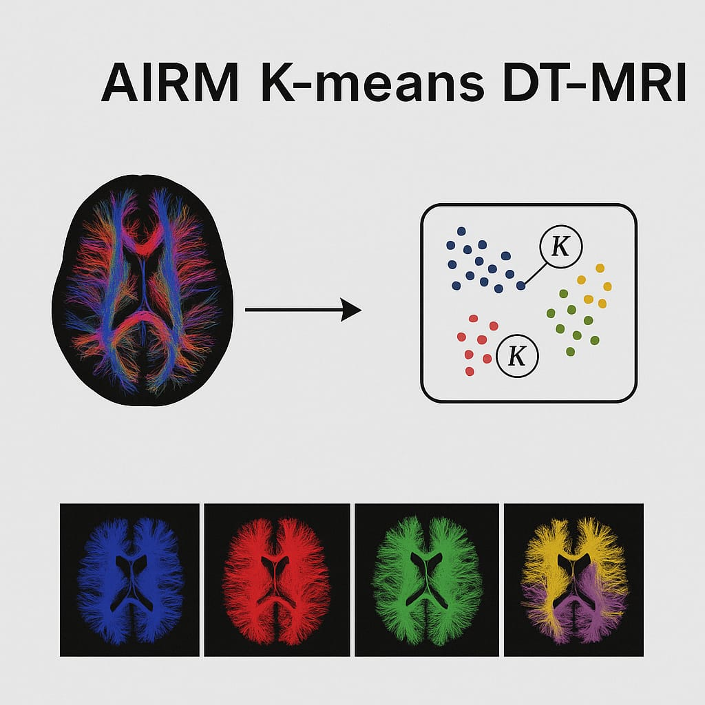

# airm-spd-kmeans-dti
DTI segmentation via k-means in SPD (AIRM, LE), NO SPD, and HYBRID SPD and NO SPD: implementation, α sweep, K ∈ {2,3,4}, LOSO validation, and statistical analysis (Wilcoxon test and y-scrambling). 

  

## Repository layout (expected)
- `src/`: core algorithms (`kmeans.py`, `utils.py`, `metrics.py`, `segment_dti.py`)
- `scripts/`: experiment runners (`build_dataset.py`, `sweep_alpha_dense.py`, `iteration_convergence.py`)
- `tests/`: statistical analysis and sanity checks (`wilcoxon_paired.py`, leakage checks, y-scramble)
- `results/` and `figures/`: generated artifacts (not tracked by git ideally)

## Environment
Use the provided `environment.yml`.
 
conda env create -f environment.yml
conda activate ned-loso
python -c "import numpy,scipy,sklearn,nibabel; print('ok')"
